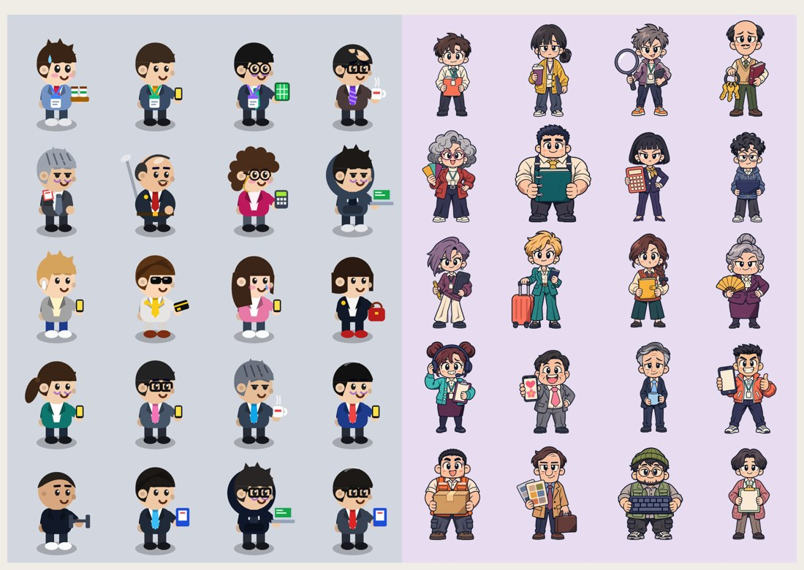

점심을 건너뛰었다. 일이 많아서는 아니고, 오전 내내 게임 업데이트 생각만 했기 때문이다. 정신 차리니 1시 반.

퇴근 서바이버즈는 퇴근하고 혼자 만들고 있는 브라우저 게임이다. 출근(오전 9시)부터 칼퇴(오후 6시)까지 메일, 회의, 메신저 알림 같은 '업무'를 쳐내며 버틴다. 10월 30일에 itch.io에 처음 올렸다.

## 그림을 전부 바꿨다

왼쪽이 원래 그림이다. 도형을 조합해서 그린 거라 작은 화면에서는 누가 누군지 잘 구분이 안됐다. 게임 얘기는 좋았는데 그림 얘기만 나오면 다들 조용해졌다 ㅋㅋ

직원 20명, 보스 4명을 새로 그렸고 걷기·숨쉬기·피격 모션을 붙였다.
걷기가 제일 애먹었다. 처음엔 다리를 옆에서 본 것처럼 회전시켰는데, 정면 그림이라 다리가 가위처럼 벌어졌다. 결국 무릎 아래만 번갈아 들어 올리는 종종걸음으로 바꿨다.

## 이틀 만에 다 깬 분

루리웹에서 한 분이 진엔딩이랑 도전과제를 이틀 만에 전부 깼다. 무한 야근 모드 한 판에 15만 원 넘게 벌어가셨다. 고맙고, 또 많이 반성했다.

- 레벨업 필요 경험치 약 30% 증가 (Lv 30까지 5,696 → 7,611)
- 반차(무적) 3초. 대신 남은 시간이 보이는 보호막으로
- 처음 온 사람은 메뉴 없이 바로 출근

다음은 남은 직원 10명 공개. 그리고 이틀 만에 못 깨는 난이도.

[플레이하기 (무료)](https://jinstonaor.itch.io/clock-out-survivors)
