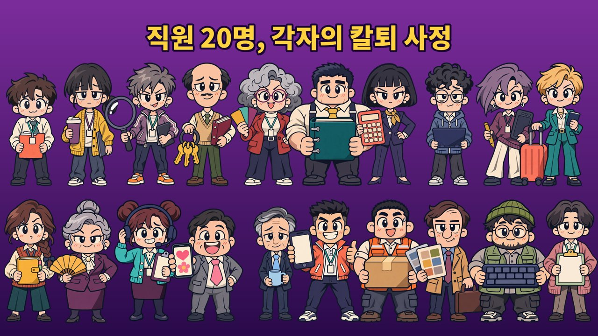

게임에 나오는 직원들을 몇 명씩 소개해 보려고 한다. 다 실제로 어딘가 있을 법한 사람들이다. (특정인 아님. 진짜로.)

**인턴 한열정 (24)**
열정만 가득, 월급은 경험으로 받는다. 커피 심부름이 특기라 시작 무기도 커피. 경험치를 20% 더 받는 대신 멘탈이 약하다. 처음 해보는 분들 대부분이 이 친구로 첫 출근을 한다.

**사원 김무난 (27)**
무난함의 끝판왕. 존재감이 없다. 입버릇은 "넵". 능력치가 전부 평균이라 오히려 제일 안정적이다.

**신입 MZ 이칼퇴 (25)**
6시 정각이면 이미 엘리베이터 안에 있다. 게임 제목이랑 제일 잘 맞는 사람이라 커버에도 넣었다. 돈 모아서 고용해야 쓸 수 있다.

개인적으로는 김무난이 제일 정이 간다. 이유는... 말 안 해도 알 것 같다.

다음 편은 대리·과장 라인. 셀 병합 장인이랑 위아래로 치이는 샌드위치 관리직.

[퇴근 서바이버즈 플레이 (무료)](https://jinstonaor.itch.io/clock-out-survivors)
